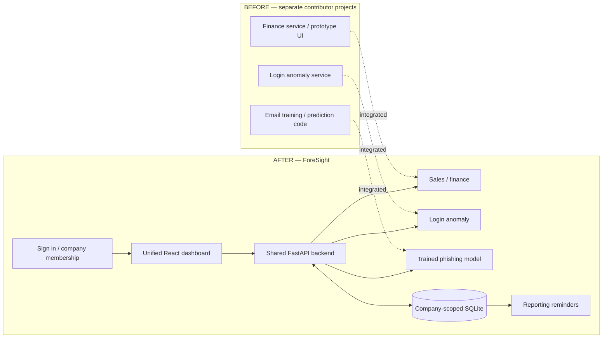

# ForeSight — Team Integration Summary

**27 October 2026 · Before → After · Local college demonstration**

The three contributor services now run as one authenticated application. Before this integration, `main` contained only the initial README; the implementation lived on separate finance, anomaly, and email-phishing branches. Contributor history is preserved.

## The big picture

## What changed and how much it affects us

**Major** changes affect capabilities, access, or data meaning. **Moderate** changes improve workflows and repeatability. **Minor** changes affect naming/presentation. Size does not mean importance.

| Size | Area | Before → After | Effect on teammates |
| --- | --- | --- | --- |
| **MAJOR** | Application integration | Separate service entrypoints → one API and seven dashboard areas | Run one application; frontend actions call real backend services. |
| **MAJOR** | Accounts and access | No shared account system; early demo switching was open → registration, login/logout, company memberships, owner/member/admin roles | Company data is restricted. Owners manage access and API keys; admins alone can select every company and use Model Lab. |
| **MAJOR** | Company data intake | Different service input formats → CSV/XLSX and API intake with mapping, validation, deduplication, and persisted records | Review column meanings before processing; retrying stable record IDs does not duplicate sales. |
| **MAJOR** | Financial interpretation | Prototype cash-stress emphasis → evaluated sales outlook, product history, and explicit scenarios; prototype retained in Model Lab | Present expected sales patterns. Do not describe sales as available cash or the experiment as a validated company-failure probability. |
| **MAJOR** | Phishing integration | Standalone code; trained export supplied later on the email branch → actual local DistilBERT inference with a pinned, checksum-verified installer | Email analysis works through the dashboard. First setup retrieves about 269 MB; large weights stay outside the source ZIP. |
| **MODERATE** | Reporting reminders | No shared reminder workflow → server-side overdue upload/process reminders, schedules, snooze/resume | Paused-API and upload-only companies receive relevant in-app reminders while the backend runs. |
| **MODERATE** | Repository and setup | Separate layouts, duplicate/generated material, environment differences → shared structure, locked dependencies, launch script, tests, and CI configuration | Fewer setup steps and clearer ownership. Use `frontend/`, `decisioniq/`, and `services/` instead of the former standalone entrypoints. |
| **MINOR** | Product branding | DecisionIQ name → **ForeSight**, graphite styling, bundled fonts | Use ForeSight in presentations. Internal `decisioniq` imports and `DECISIONIQ_*` settings remain compatible; dashboard consolidation itself is a major change above. |

## How data moves now

**Sales:** upload / company API → review mapping → validate → save company records → compare forecast with baseline → dashboard.

**Security:** login event / email input → local model → save company-scoped result → review signal. Finance and security remain separate evidence streams.

## What each teammate should do

1. Use a fresh clone of `main` to avoid overwriting an older dirty checkout. Requires Python 3.11/3.12, Node.js 22+, and `uv`.
2. Run `./scripts/run_local.sh`; open `http://127.0.0.1:8082` and create an account. First setup downloads the pinned model; subsequent launches verify/reuse it.
3. Owners add existing registered teammates through **Manage team**. There are no default passwords. An operator can promote a registered account locally with `uv run python -m scripts.create_admin --email your-email --promote`.
4. After upgrading an earlier demo installation, issue new company API keys: old demo-issued keys are revoked once. Stored sales remain preserved. Older unowned workspaces require an admin to assign an owner.

## Evidence and practical limits

- **Verified locally:** 47 backend/model/installer checks and 12 browser workflows, including actual trained email inference. Python 3.12 core: 44 passed; three optional model checks skipped in that environment.
- **Phishing evaluation:** 99.00% accuracy on 2,000 emails from the reconstructed source test split; **15 missed phishing emails and 5 false alarms**. This is not external/temporal validation. A separate synthetic credential lure was missed; an unflagged message is not proof of safety.
- **Sales:** Prophet is selected only if it beats a weekly baseline on the final 28-day holdout. Public sample workspaces represent country segments of one historical retailer, not three observed companies.
- **Still open:** durable job/restart recovery, broader forecast/model evaluation, email verification/password recovery, retention/backups, and production deployment. External LLM/GenAI mapping remains disabled pending the privacy decision.

Publishing code to `main` does not deploy a hosted website. See [setup and API details](../README.md), [full implementation report](IMPLEMENTATION_REPORT.md), and [model provenance](../services/phishing/PROVENANCE.md).
